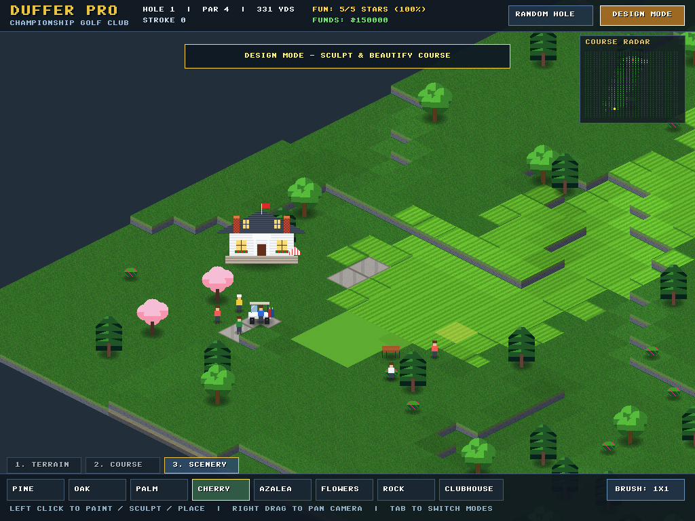
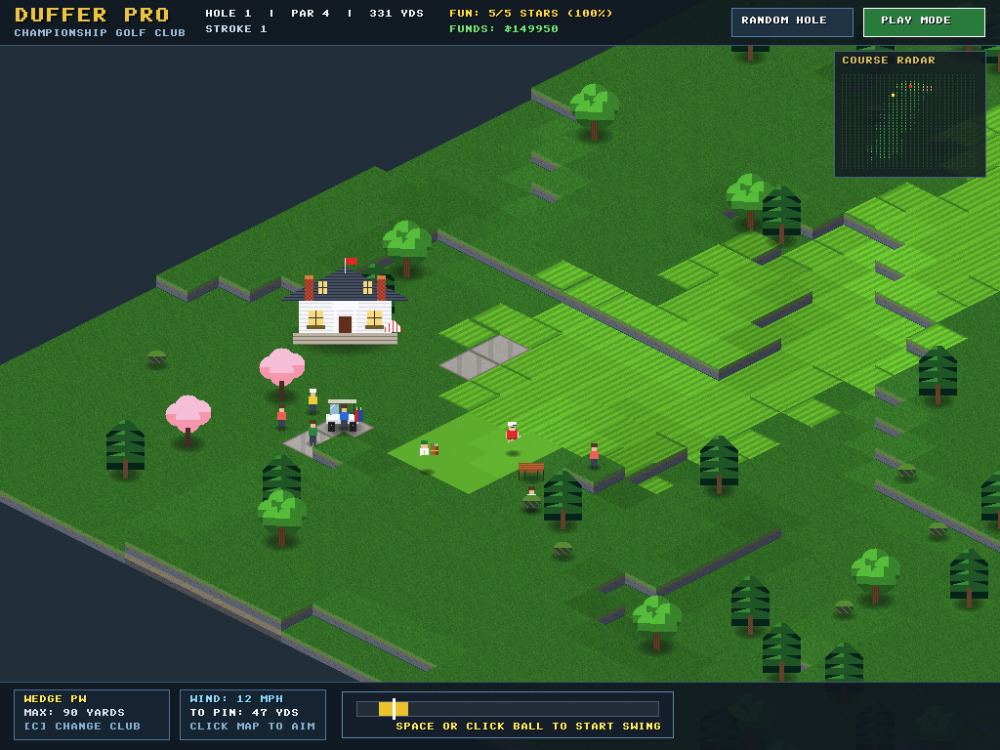
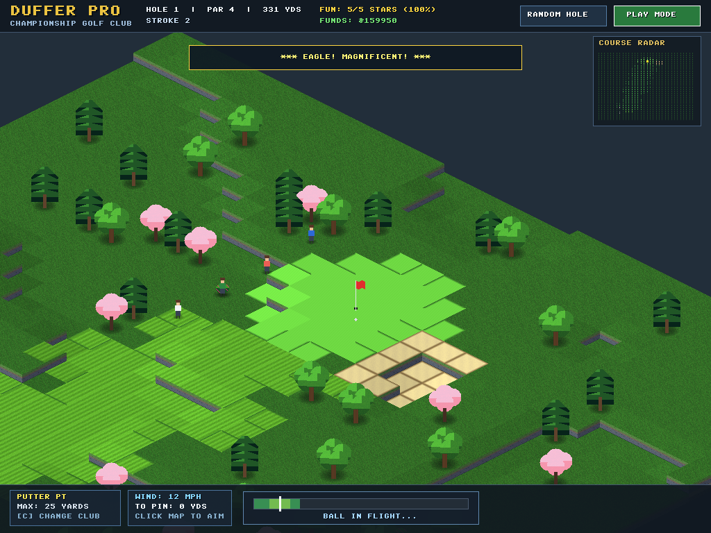

# Duffer Pro ⛳

> **A High-Definition 2.5D Isometric Golf Simulation & Course Architect**  
> Inspired by mid-2000s classics (*Sid Meier's SimGolf*, *RollerCoaster Tycoon 3*, *Diablo II*).


---

## 🌟 Highlights & Architectural Pillars

- **Pure ANSI C (C99):** Built from scratch without C++, OOP bloat, external math libraries, or GPU shader dependencies.
- **High-Definition 1024×768 Canvas:** Crisp, modern isometric rendering with 2:1 projection ($64\times 32$ px diamond tiles).
- **Two-Pass Screen-Space Depth Pipeline:** 
  - **Pass 1:** Renders the terrain grid in diagonal scan order ($d = 0 .. 126$), writing surface and cliff wall depth keys into a screen-space depth buffer.
  - **Pass 2:** Back-to-front depth-sorted drawables (scenery, characters, props, ball) with soft elliptical alpha drop shadows and depth occlusion against foreground terrain.
- **7-Tier Elevation & Real-Time Sculpting:** Sculpt terrain live with **Raise (+)** and **Lower (-)** brush tools across 7 elevation tiers (Water $\to$ Peak) with dynamic cliff skirts and layered sedimentary rock strata.
- **Stately Country Club Estate:** Multi-tier Georgian neoclassical clubhouse featuring pitched slate roof with dormers, twin brick chimneys with terracotta flue pots, white colonnade portico, leaded mullion windows, stone veranda with café tables, striped patio umbrella, and red geranium flower boxes.
- **Dynamic Caddy & Spectator Gallery:**
  - **Caddy Companion:** Follows the golfer carrying a heavy leather tour staff bag with pom-pom wood headcovers and chrome irons, pacing behind shots, stepping smoothly across terrain, and celebrating holed putts.
  - **Spectator Gallery:** Up to 24 gallery spectators with 5 distinct country club attire variations (Panama hats, rugby polos, visors, sunglasses). They track ball flight, clap politely on fairway drives, cheer on birdies/eagles, and gasp at hazard landings.
- **SimGolf Economy & Fun Rating:** Real-time course rating (0–100%, 0–5 stars), difficulty scoring, and club treasury funds ($150,000 baseline) with construction fees and tournament purse winnings.
- **Rich Procedural Soundscape:** 100% procedural synthesized audio with golf applause, roaring crowd cheers, gasp/oohs, wood footstep echoes on bridges, driver whack / sweet-spot cracks, sand trap thuds, cup sink rattle, and dynamic clubhouse patio murmur that swells as you approach the estate.
- **Expanded Build Palette:** Cartpaths, wooden bridges, Scots pines, English oaks, royal palms, flowering cherry trees, azalea bushes, wildflower beds, granite boulders, park benches, and golf carts.
- **Deterministic 16.16 Fixed-Point Math:** `fixed_math.h` implements complete 16.16 arithmetic, integer square root, and 256-angle sine/cosine LUT. Zero floating-point calculations in physics or vector updates.

---

## 📸 In-Game Screenshots

| Title Splash Screen | Hole 1 Tee & Country Club |
| :---: | :---: |
|  |  |

| Design & Scenery Palette | Real-Time Terrain Sculpting |
| :---: | :---: |
|  |  |

| Smooth Walking Movement | Holed Putt & Celebration |
| :---: | :---: |
|  |  |

---

## 🎮 Controls & Hotkeys

| Action | Control | Description |
| :--- | :--- | :--- |
| **Switch Modes** | `Tab` or UI Button | Toggle between **Play Mode** and **Design Mode** |
| **Aim Shot** | `Left Click` on Map | Sets target landing spot; auto-selects ideal club |
| **Swing (3-Click)** | `Space` or `Click Ball` | Click 1: Start backswing; Click 2: Power; Click 3: Accuracy snap |
| **Cycle Clubs** | `C` key | Switch between Driver (1W), Wood (3W), Irons (4I..9I), Wedges, Putter |
| **Pan Camera** | `Right Click + Drag` / Mouse Edge / Arrows | Smooth isometric camera scrolling |
| **Design Category** | `1`, `2`, `3` | Switch tabs: 1: Terrain, 2: Course, 3: Scenery |
| **Toggle Brush** | `B` key | Toggle between 1×1 tile and 3×3 brush |
| **Sculpt / Paint** | `Left Click / Drag` | Raise/lower terrain, paint surfaces, or place scenery |
| **Randomize Hole** | `R` key or UI Button | Generates a brand-new championship layout |

---

## 🏗️ Directory Structure

```
Duffer/
├── Makefile                   # Multiplatform GCC Makefile (Windows/Linux/macOS)
├── .gitignore                 # Git ignore rules
├── README.md                  # Comprehensive engine documentation
├── build/                     # Runnable executable output directory
│   ├── duffer.exe             # Primary Duffer Pro binary
│   ├── duffer_pro.exe         # Convenience alias binary
│   └── SDL2.dll               # SDL2 32-bit runtime (MinGW)
├── docs/
│   └── screenshots/           # In-engine 1024x768 screenshots
│       ├── screenshot_splash.png
│       ├── screenshot_play.png
│       ├── screenshot_design.png
│       ├── screenshot_walking.png
│       ├── screenshot_sculpt.png
│       └── screenshot_holed.png
├── src/
│   ├── fixed_math.h           # Deterministic 16.16 fixed-point math & LUT trig
│   ├── font8x8.h              # Razor-sharp retro 8x8 bitmap font
│   ├── golf_audio.h           # Procedural synthesized audio engine interface
│   ├── golf_audio.c           # Dynamic soundscape, crowd reactions, patio murmur
│   ├── golf_core.h            # Headless simulation API, entities, course ratings
│   ├── golf_core.c            # Procedural terrain, 16-mask autotiler, physics, economy
│   ├── golf_render.h          # Software isometric blitter interface (1024x768)
│   ├── golf_render.c          # Depth buffer, drop shadows, procedural pixel art, HUD
│   ├── splash_art.h           # Procedural splash art rasterizer & 3D logo
│   └── main.c                 # SDL2 frontend, camera tracking, event loop
├── tools/
│   └── capture_test.c         # Headless verification & screenshot capture tool
└── vendor/
    └── SDL2/                  # Vendored 32-bit MinGW development library
```

---

## 🚀 Building & Running

### Requirements
- **Windows:** MinGW GCC with 32-bit SDL2 (vendored in `vendor/SDL2/`)
- **Linux:** `gcc`, `libsdl2-dev`, `make`
- **macOS:** `clang`, `sdl2` via Homebrew, `make`

### Compile & Launch
```powershell
# Build both duffer.exe and duffer_pro.exe:
mingw32-make clean; mingw32-make

# Run the game:
.\build\duffer.exe
```
