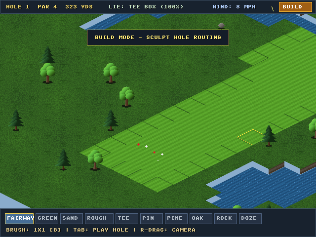
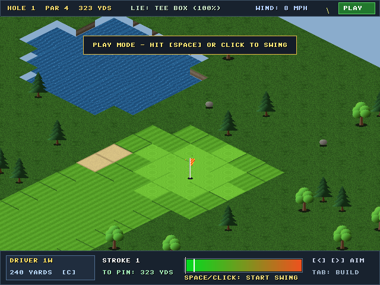

# RetroSimGolf-1H ⛳

> **A Lightweight, Single-Hole 2.5D Isometric Golf Engine**  
> Inspired by late-90s and early-2000s classics (*Sid Meier's SimGolf*, *RollerCoaster Tycoon* terrain).


---

## Highlights & Architectural Pillars

- **Pure ANSI C (C99):** No C++, OOP runtimes, external math frameworks, or GPU shader pipelines.
- **Decoupled Simulation Core:** Headless simulation in `golf_core.c` and `golf_core.h` with zero OS or graphical dependencies.
- **Deterministic 16.16 Fixed-Point Math:** `fixed_math.h` implements complete 16.16 arithmetic, integer square root, and 256-angle sine/cosine LUT. **Zero floating-point (`float`/`double`)** calculations in physics or vector updates.
- **2:1 Stepped Isometric Projection:** 64×32 pixel diamond tiles, 12-pixel discrete elevation tiers, vertical cliff skirts to seal tier gaps, and Y-sorted dynamic entities.
- **Self-Contained Procedural Pixel Art:** All tiles (Fairway mowing stripes, Rough grass stippling, Sand bunker grain, Green swirl, Animated water ripples), cliff rock strata, trees, rocks, flags, golfer, and HUD fonts are procedurally generated in code. Runs immediately without external asset files!
- **Dual Mode Workflow:**
  - **Build Mode:** Interactive hole routing, Tee & Pin cup placement, automatic distance (yards) & Par computation (Par 3/4/5), brush-based Fairway painting with 16-bitmask autotiling, Green painting, Sand traps, and Obstacle placement (Pine, Oak, Granite Boulders).
  - **Play Mode:** Authentic 3-click links-style swing gauge (Power & Accuracy snap), club selection (Driver to Putter), trajectory integration (wind offset, gravity, drag, tree canopy deflections, surface restitution, and slope rolling).

---

## Screenshots

| Play Mode (Tee Box & Fairway) | Build Mode (Hole Sculpting) | Green & Pin Cup View |
| :---: | :---: | :---: |
|  |  |  |

---

## Directory Structure

```
Duffer/
├── Makefile                   # Multiplatform GCC Makefile (Windows/Linux/macOS)
├── .gitignore                 # Sanitized Git ignore rules
├── README.md                  # Comprehensive engine documentation
├── build/                     # Runnable executable output directory
│   ├── retrosimgolf.exe       # Game binary
│   └── SDL2.dll               # SDL2 32-bit runtime (MinGW)
├── docs/
│   └── screenshots/           # Engine screenshots
│       ├── screenshot_play.png
│       ├── screenshot_build.png
│       └── screenshot_green.png
├── src/
│   ├── fixed_math.h           # Deterministic 16.16 fixed-point math & LUT trig
│   ├── font8x8.h              # Razor-sharp retro 8x8 bitmap font
│   ├── golf_core.h            # Headless simulation API, grid, clubs, ballistics
│   ├── golf_core.c            # Procedural terrain, 16-mask autotiler, physics
│   ├── golf_render.h          # Software isometric blitter interface
│   ├── golf_render.c          # Procedural pixel art, cliff skirts, HUD, BMP saver
│   └── main.c                 # SDL2 frontend, event loop, input mapping
├── tools/
│   ├── capture_test.c         # Headless screenshot verification utility
│   └── gen_font.py            # Font generator script
└── vendor/
    └── SDL2/                  # Vendored 32-bit MinGW development library
```

---

## Core Systems

### 1. Procedural Terrain Canvas (Immutable Elevation)
- Grid dimensions: $32 \times 64$ tiles.
- 4 discrete elevation tiers:
  - Tier 0: Water Basin (Hazard)
  - Tier 1: Lowland
  - Tier 2: Ridge
  - Tier 3: Plateau
- Generated using a low-frequency noise lattice, bilinear interpolation, and a 3-pass cellular smoothing filter.
- Natural hazards: Clustered conifer pine stands, deciduous oak groves, and granite boulders generated on native rough and slopes.

### 2. 16-Tile Autotiling Bitmask
Every tile evaluates its 4 cardinal diamond edges (NW, NE, SE, SW):
$$\text{mask} = (\text{NW} \ll 3) \mid (\text{NE} \ll 2) \mid (\text{SE} \ll 1) \mid (\text{SW} \ll 0)$$
Edge transitions are dynamically blended to create organic scalloped fringes where Fairway meets Rough, or where Sand Traps cut into the turf.

### 3. Ball Flight & Physics Engine
All kinematic vectors use 16.16 fixed-point arithmetic (`fixed`):
- **In-Flight Integration:**
  $$\vec{v}_{t+1} = \left(\vec{v}_t + \vec{g} + \vec{w}\right) \cdot c_d$$
- **Obstacle Collisions:** Tree trunks and 3D leaf canopies deflect ball velocity downward with foliage scattering. Boulder collisions produce chaotic ricochets.
- **Ground Restitution:**
  - *Green:* High bounce ($e = 0.50$), low friction ($\mu = 0.96$).
  - *Fairway:* Balanced bounce ($e = 0.40$), standard roll ($\mu = 0.92$).
  - *Rough:* Damped bounce ($e = 0.15$), high friction ($\mu = 0.80$).
  - *Sand Bunker:* Dead stop ($e = 0.05$), heavy friction ($\mu = 0.55$).
  - *Water Hazard:* Ball splashes; adds 1 penalty stroke and drops back to previous lie.
- **Slope Rolling:** Rolling velocity accelerates down the local elevation gradient:
  $$\vec{a}_{\text{slope}} = -\nabla \text{elev} \cdot k_{\text{slope}}$$
- **Cup Sink:** When rolling within cup radius ($0.33$ tiles) below cutoff speed, the ball sinks into the cup and triggers hole completion.

### 4. Golf Clubs
| Club | Nom. Distance | Launch Angle | Roll / Backspin | Type |
| :--- | :---: | :---: | :---: | :--- |
| **Driver (1W)** | 240 Yds | $14^\circ$ | High roll | Aerial |
| **3-Wood (3W)** | 215 Yds | $18^\circ$ | Med-high roll | Aerial |
| **5-Iron (5I)** | 175 Yds | $28^\circ$ | Moderate roll | Aerial |
| **9-Iron (9I)** | 130 Yds | $40^\circ$ | Soft landing | Aerial |
| **Pitching Wedge (PW)** | 90 Yds | $50^\circ$ | High backspin | Aerial |
| **Putter (PT)** | 25 Yds | $0^\circ$ | Pure roll | Ground Roll |

---

## Controls Reference

### Universal Controls
| Key / Input | Action |
| :--- | :--- |
| `[TAB]` | Toggle between **Play Mode** and **Build Mode** |
| `[R]` | Reset ball to Tee marker |
| `[G]` | Regenerate new procedural terrain & routing |
| `[F12]` | Capture BMP screenshot to disk |
| `[ESC]` | Exit game |
| **Right-Click Drag** | Pan isometric camera across the course |

### Play Mode
| Key / Input | Action |
| :--- | :--- |
| `[SPACE]` or **Left Click** | **3-Click Swing Gauge:**<br>• Click 1: Start power needle<br>• Click 2: Lock power level (0–100%)<br>• Click 3: Lock accuracy sweetspot (Straight / Slice / Hook) |
| `[A]` / `[D]` or `[←]` / `[→]` | Rotate aim angle |
| `[W]` / `[S]` or `[↑]` / `[↓]` or `[C]` | Cycle club selection |

### Build Mode
| Key / Input | Action |
| :--- | :--- |
| **Left Click / Drag** | Stamp / paint selected terrain tool on map |
| `[B]` | Toggle brush size ($1\times1 \leftrightarrow 2\times2$) |
| `[1]` .. `[0]` | Quick tool select:<br>`[1]` Fairway &nbsp; `[2]` Green &nbsp; `[3]` Sand &nbsp; `[4]` Rough<br>`[5]` Tee Marker &nbsp; `[6]` Pin Cup<br>`[7]` Pine Tree &nbsp; `[8]` Oak Tree &nbsp; `[9]` Rock &nbsp; `[0]` Bulldoze |

---

## Compiling & Running

### Windows (MinGW / GCC)
The repository includes vendored 32-bit SDL2 development headers and binaries:
```sh
# Build the executable directly from root
mingw32-make

# Run from build directory
cd build
./retrosimgolf.exe
```

### Linux (Ubuntu / Debian / Fedora / Arch)
Install SDL2 development headers:
```sh
# Debian/Ubuntu
sudo apt-get install libsdl2-dev build-essential

# Fedora
sudo dnf install SDL2-devel gcc make

# Compile & run
make
./build/retrosimgolf
```

### macOS
Install SDL2 via Homebrew:
```sh
brew install sdl2
make
./build/retrosimgolf
```

---

## License
MIT License. Inspired by late-90s golf and tycoon games.
