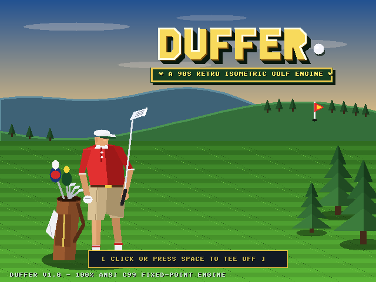
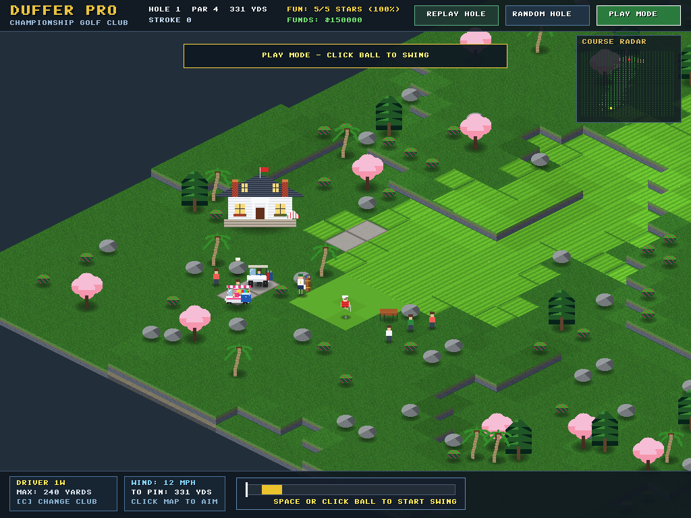
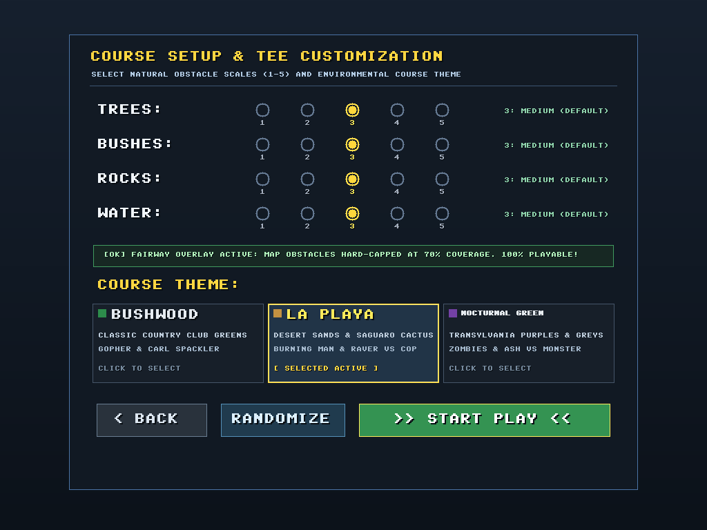
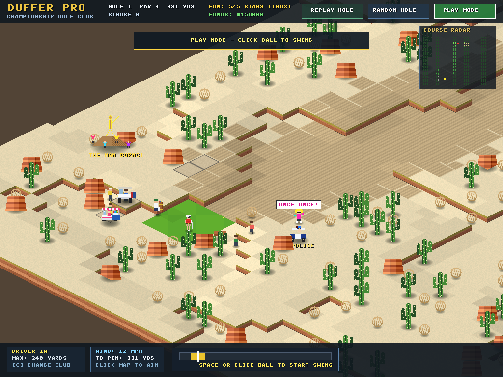
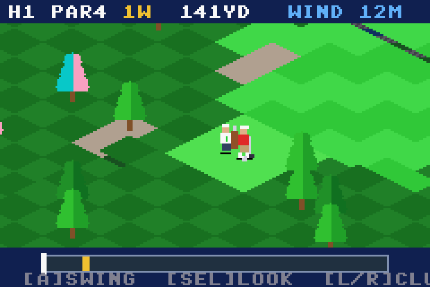

# Duffer Pro ⛳

> **High-Definition 2.5D Isometric Golf Simulation & Course Architect**  
> *Version `0.75-noonan`* (SemVer: `v0.7.5`) — Pure ANSI C99 · Windows · macOS Sonoma · Game Boy Advance



---

## 🌟 Overview

- **Classic Retro Heritage:** Inspired by mid-2000s isometric gems (*Sid Meier's SimGolf*, *RollerCoaster Tycoon 3*) and *Caddyshack*.
- **Pure ANSI C99:** Built completely from scratch with zero OOP bloat, external math libraries, or GPU shader requirements.
- **Deterministic 16.16 Physics:** Zero floating-point drift in physics, wind, elevation vectors, or swing execution.
- **Three Environmental Themes:**
  - **Bushwood:** Georgian neoclassical clubhouse, caddyshack crew, and Carl Spackler vs. the Gopher.
  - **La Playa:** Desert plateau, giant cacti, tumbleweeds, rapids, Burning Man effigy, and dancing raver vs. police cart.
  - **Nocturnal Green:** Gothic Transylvanian castle, autumn foliage, coffin rock piles, dark monster lagoons, zombies, and Ash with his boomstick.
- **Multi-Platform Native Support:** Windows PC, macOS Sonoma (Universal 2: Apple Silicon + Intel), and bare-metal Game Boy Advance.
- **Full User Manual:** Detailed gameplay rules, club breakdowns, and course architect guides are in the [📖 Official User Manual](wiki/User-Manual.md).

---

## 📸 Screenshots

| Hole 1 Fairway & Bushwood Estate | Course Setup & Density Tuning |
| :---: | :---: |
|  |  |

| La Playa Desert & Burning Man | Game Boy Advance Edition |
| :---: | :---: |
|  |  |

---

## 🎮 Key Features

- **3-Click Swing Gauge:**
  - Click 1: Start backswing.
  - Click 2: Lock power (with auto-bounce at 100%).
  - Click 3: Lock accuracy in the sweet spot (or shape hooks and slices).
- **Sub-Tile Mouse Aiming:**
  - Click or drag anywhere to place the reticle ring.
  - Continuous coordinate inversion matches mouse pointer with sub-pixel precision.
  - Automatic club selection calibrated to target distance.
  - Complete launch immunity when hitting out of tree, bush, or boulder tiles.
- **Sneak On Mode:**
  - Quick rounds with randomized obstacle density and themes.
  - Watch out for the patrol ranger in his golf cart!
- **Play a Hole Mode:**
  - Full customization dashboard with 1–5 sliders for Trees, Bushes, Rocks, and Water.
  - Strict 70% natural obstacle safety clamp ensures playable fairway routing.
- **Replay Hole:**
  - Instant one-click restart (`R` key or UI button) for the exact same layout.
- **Live Course Architect (Design Mode):**
  - Sculpt 7 discrete elevation tiers with dynamic sedimentary cliff walls.
  - Paint fairways, greens, sand traps, cart paths, and bridges in real time.
- **Synthesized Audio Soundscape:**
  - 100% procedural audio: driver cracks, sweet-spot chimes, cup rattles, gallery cheers, and ambient clubhouse murmur.

---

## ⌨️ Controls

- **`Tab`:** Toggle between Play Mode and Course Architect (Design Mode)
- **`Left Click`:** Set aiming reticle / click ball or screen to swing
- **`Space`:** Universal 3-click swing trigger (Start $\to$ Power $\to$ Accuracy)
- **`R`:** Replay current hole layout
- **`C`:** Cycle clubs forward (Driver $\to$ 3W $\to$ 5I $\to$ 9I $\to$ PW $\to$ Putter)
- **`Arrow Keys` / `Right-Click Drag`:** Smooth isometric camera panning
- **`1`, `2`, `3`:** Design mode tool tabs (Terrain, Surfaces, Scenery)
- **`B`:** Toggle brush size (1×1 tile vs. 3×3 broad)
- **`Esc`:** Return to title screen / cancel tool

---

## 📦 Downloads & Releases (`v0.75-noonan`)

| Package | Format | Direct Download | Details |
| :--- | :---: | :---: | :--- |
| **All-in-One Release Bundle** | `.zip` (4.7 MB) | [Download ZIP](https://github.com/andarazoroflove/DufferPro/releases/download/v0.75-noonan/Duffer_Pro_v0.75-noonan.zip) | Windows, macOS Sonoma Universal 2, and GBA builds |
| **macOS Sonoma App** | `.zip` (1.9 MB) | [Download App](https://github.com/andarazoroflove/DufferPro/releases/download/v0.75-noonan/Duffer_Pro_macOS_Sonoma.zip) | Universal 2 `Duffer Pro.app` (Apple Silicon & Intel) |
| **Game Boy Advance ROM** | `.gba` (512 KB) | [Download ROM](https://github.com/andarazoroflove/DufferPro/releases/download/v0.75-noonan/duffer_pro.gba) | Real hardware & SuperCard / EverDrive ready |
| **Windows Standalone** | Executable | [View Folder](release/windows/) | `duffer_pro.exe` + `SDL2.dll` (no installer needed) |

---

## 🛠️ Building from Source

```bash
# Windows (MinGW)
mingw32-make clean && mingw32-make

# macOS Sonoma (Universal 2 via cross-toolchain or native clang)
mingw32-make mac

# Game Boy Advance (Bare-Metal ARM GCC)
mingw32-make gba
```

---

## 📚 Documentation & Guides

- [📖 Official User Manual](wiki/User-Manual.md) — Comprehensive player manual and strategy guide.
- [🏛️ Wiki Home](wiki/Home.md) — Documentation index and release notes.

---

## 🏷️ Versioning Scheme

- **Step Changes:** Incremented by `0.0.xx` on each step build (`0.7.5` $\to$ `0.7.6` $\to$ `0.7.7`...).
- **Milestone Rollover:** Increment the middle digit at `x.x.99` (`0.7.99` $\to$ `0.8.0`).
- **Published Releases:** Formal public releases are tagged and published strictly on ending multiples of 5 (e.g., `0.7.5`, `0.7.10`, `0.7.15`, ...).

